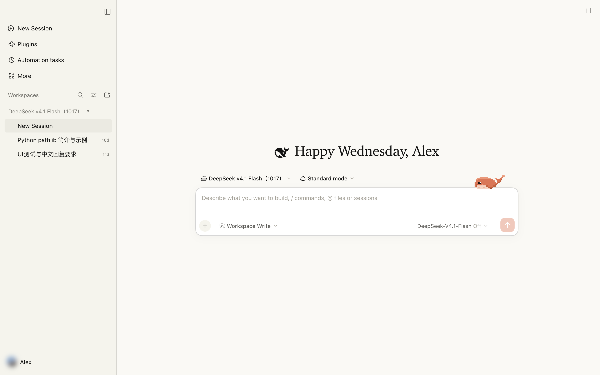
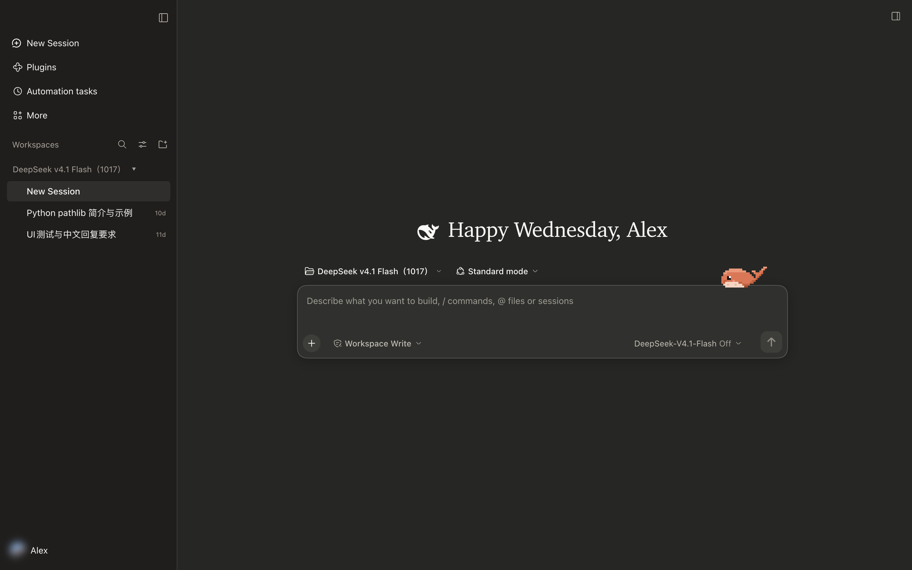
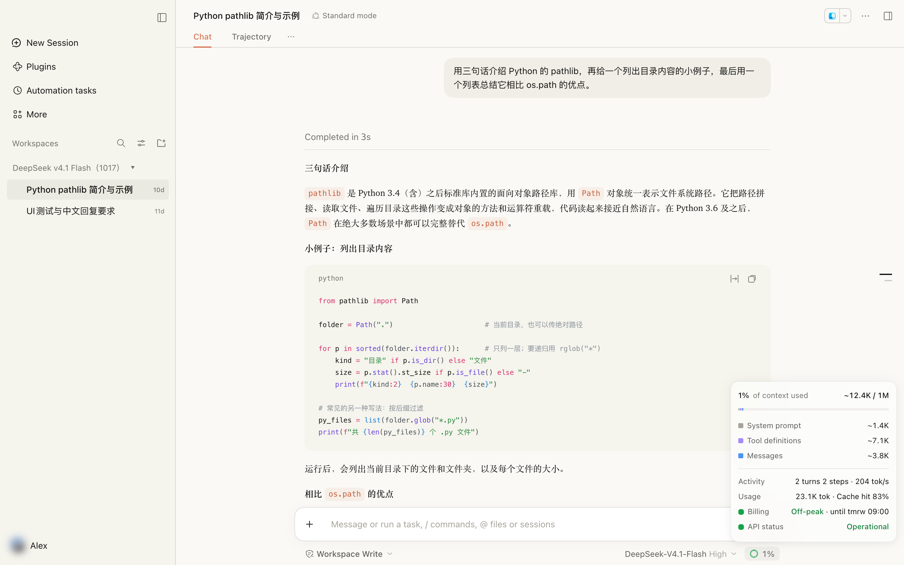
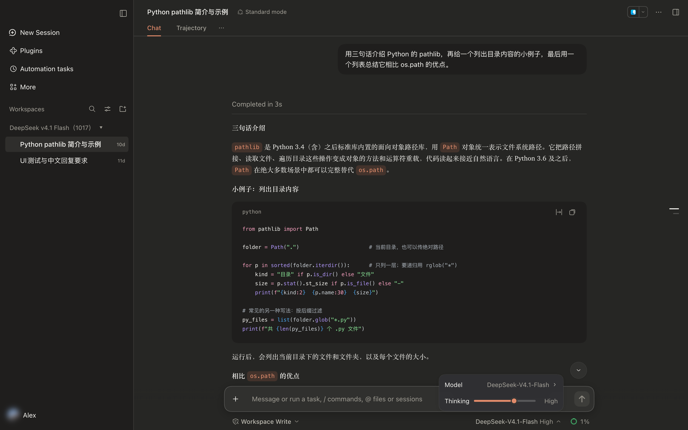
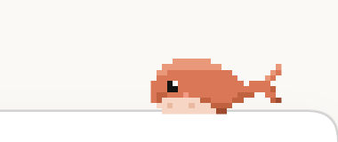

# dsh-claude-ui

[中文](README.md) | English

A DeepSeek Harness plugin that makes its interface look and feel like Claude Desktop.









- **Colors**: warm greys with a clay accent (`#D97757`); light and dark follow the system. In dark mode, menus and popovers sit one step lighter than the composer, and caption text and disabled buttons have been tuned for contrast
- **Layout**: serif body text, clay inline code and rounded user bubbles. The sidebar drops the DeepSeek Harness logo, "New Session" becomes a plain row, and workspace headings read "Name ▾"
- **Composer**: in a chat the composer keeps a single "+ | input | send" row, with permission mode, model and the context ring on the line below. The turn, token and cache-hit stats move into the context ring: click the ring and they sit at the bottom of its panel
- **Peak / off-peak billing**: the ring follows DeepSeek API billing hours. It is red at peak (weekdays 09:00–12:00 and 14:00–18:00 Beijing time) and green off-peak, and the panel shows the current period and when it changes next. Chinese public holidays are billed off-peak but still show as weekdays here
- **API status**: the panel shows DeepSeek's official API status from [status.deepseek.com](https://status.deepseek.com), refreshed every 3 minutes. While an incident is open, a small amber dot appears on the ring; click the row to open the status page
- **Thinking effort**: the model menu's Effort row becomes a slider (Off / Low / High / Max). Drag it or use the arrow keys, with no submenu to drill into
- **Greeting**: the new-session title becomes a greeting that changes with the time of day, such as "Good morning, Alex" or "Happy Wednesday, Alex", using your DeepSeek account name
- **Pixel whale**: a little whale rests on the new-session composer. Idle, it sways its tail, flaps a fin, blinks and spouts now and then. Hover the composer and it blushes and waves; click into it and it watches the text; type and its tail goes fast. When you send, it crouches, leaps and splashes down, and late at night it dozes with z's and bubbles. It stays still when the system's Reduce Motion setting is on

  
- **Plugin market**: if [dshmarket](https://github.com/dsh-market/dsh-market) is also installed, its sidebar entry is switched on once (an explicit off is respected)
- **Languages**: all added text follows DeepSeek Harness's language (Chinese or English)

No official files are touched; uninstalling restores the stock interface.

> Built for DeepSeek Harness 0.2.2. dsh is still in preview, so some styles may break after an upgrade.

## Install

**From the app**: sidebar **Plugins** → the small arrow next to **Add plugin** → **Install third-party plugin**. Paste the address below, click **Enable now**, then restart the app.

```
https://github.com/NaianCN/dsh-claude-ui/archive/refs/heads/main.tar.gz
```

**From the command line** (macOS desktop app):

```bash
"/Applications/DeepSeek Harness.app/Contents/Resources/runtime/cli/bin/dsh" plugin --profile desktop add https://github.com/NaianCN/dsh-claude-ui/archive/refs/heads/main.tar.gz
```

On Windows, or with `dsh web` installed from npm, replace the path with your `dsh` command (the `dsh web` profile is `web`). The address is GitHub's source tarball, so Git is not needed.

For the sidebar plugin market, also install dshmarket (1.73 or later), restart, then reload the page once (⌘R):

```bash
"/Applications/DeepSeek Harness.app/Contents/Resources/runtime/cli/bin/dsh" plugin --profile desktop add dshmarket
```

## Update and uninstall

An install from an address does not update itself; to update, uninstall and install again. Uninstall from the **Plugins** page, or run:

```bash
"/Applications/DeepSeek Harness.app/Contents/Resources/runtime/cli/bin/dsh" plugin --profile desktop remove dsh-claude-ui
```

## FAQ

- **Nothing changed after installing**: quit the app completely and reopen it. Closing the window may leave the app running in the menu bar
- **The greeting has no name**: you are not signed in to a DeepSeek account
- **API status always says "Unknown"**: this computer can't reach status.deepseek.com (the local dsh service reads it)

## Fonts

The greeting, assistant replies and headings use a serif. The rest of the interface (sidebar, buttons, code) is unchanged. The first installed font in this order is used:

| | Latin and digits | Chinese |
| --- | --- | --- |
| macOS | Charter | Songti SC |
| Windows | Cambria | Source Han Serif, else Microsoft YaHei |

Why these:

- Not Georgia: its old-style figures make "0" look like a lowercase o
- Not Times New Roman: it is narrow and small, and looks short next to Chinese
- Not SimSun on Windows: its strokes are too thin and render grey and blurry
- Full-width punctuation gets its own face; Songti SC's small, left-leaning "？" and "！" come from Hiragino Mincho instead

**Better fonts without touching code**: these rank ahead of the defaults and are picked up after a restart once installed.

- Latin: [Source Serif 4](https://github.com/adobe-fonts/source-serif/releases) (free, closest to Claude)
- Chinese (recommended on Windows): [Source Han Serif / Noto Serif SC](https://github.com/adobe-fonts/source-han-serif/releases)

**Any font you like**: edit the `SERIF` line in `lib/client.js` and put your font first (after the punctuation face `CJK_PUNCT_FACE`). For example, Times New Roman for Latin:

```js
const SERIF = `"${CJK_PUNCT_FACE}", "Times New Roman", "Songti SC", ...`;
```

Code changes need the local link install described under Customize.

## Customize

The interface code is all in `lib/client.js`; `lib/index.js` only relays the official status page. Restart the app after a change; there is no build step.

- Colors: `STATIC_TOKENS` and `ALIAS_TOKENS`, each entry `{ light, dark }`
- Styles: `CSS`. Selectors rely only on `data-*` attributes and class suffixes, so they survive dsh's hashed class names between versions
- Greetings: `GREETINGS`

For local development, install with link so changes apply directly:

```bash
git clone https://github.com/NaianCN/dsh-claude-ui.git
"/Applications/DeepSeek Harness.app/Contents/Resources/runtime/cli/bin/dsh" plugin --profile desktop add link:$(pwd)/dsh-claude-ui
```

## License

MIT
