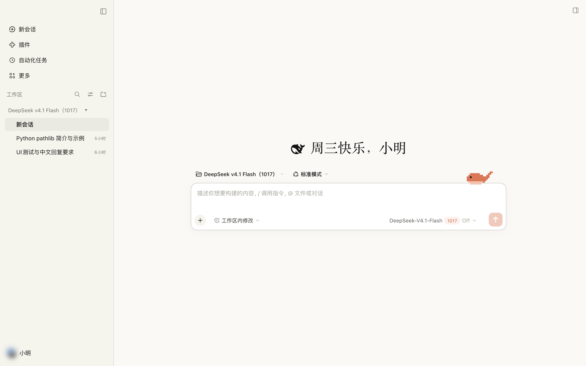
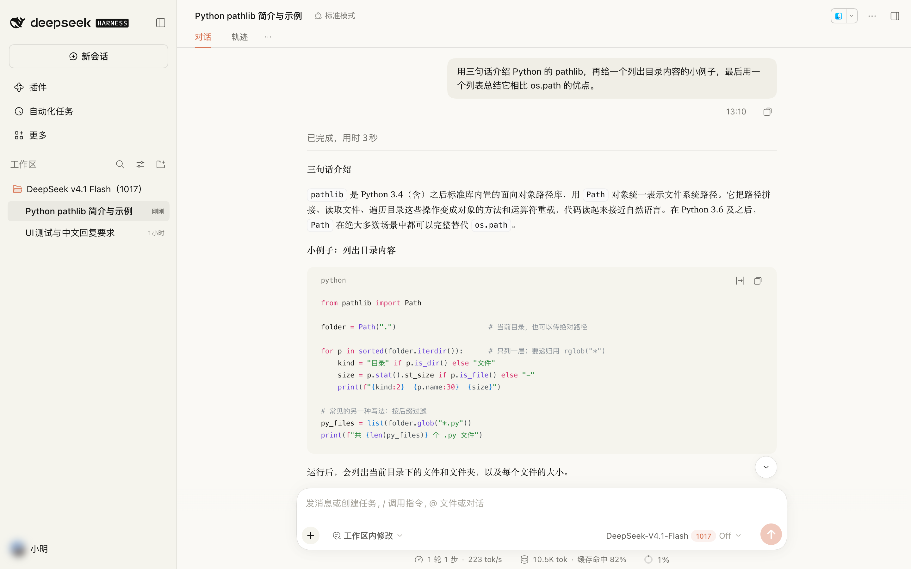
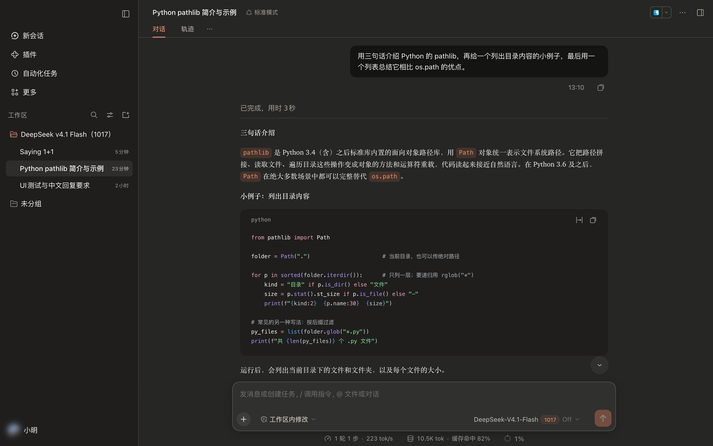
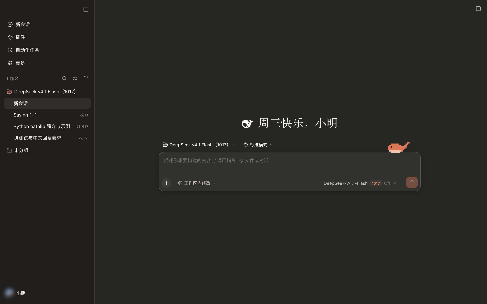

# dsh-claude-ui

把 DeepSeek Harness 的界面换成接近 Claude Desktop 的样子。



<p>
  
  
</p>

<details>
<summary>深色欢迎页</summary>



</details>

- **配色**：暖灰底色配陶土橙（`#D97757`），浅色 / 深色跟随系统
- **布局**：衬线体正文、橙色行内代码、圆角用户气泡；侧栏去掉 DeepSeek Harness 标志，「新会话」改成普通列表行，工作区标题改成「名称 ▾」的样式
- **输入框**：会话页的输入框只保留一行「+ ｜输入｜发送」，权限模式、模型和上下文圆圈移到输入框下方。原来的轮次、Token 用量、缓存命中统计并进了上下文圆圈：点圆圈，弹窗底部能看到
- **欢迎语**：新会话标题换成按时段变化的问候，如「早安，小明」「周三快乐，小明」，名字取自登录的 DeepSeek 账号；鲸鱼保留，输入框右上角还趴着一只像素小鲸鱼：会眨眼、偶尔喷水，你打字时它摆尾巴，发送时跳一下，深夜会睡着（系统开启「减少动态效果」时静止）
- **插件市场**：同时装了 [dshmarket](https://github.com/dsh-market/dsh-market) 时，自动在侧栏打开「插件市场」入口（你手动关掉过就不再打开）

不改动任何官方文件，卸载后界面恢复原样。

> 适用于 DeepSeek Harness 0.2.1。dsh 仍在预览阶段，升级后部分样式可能失效。

## 安装

**界面安装**：侧栏 **插件** → **添加插件** 右侧小箭头 → **安装第三方插件**，填入下面的地址，安装后点 **立即启用** 并重启应用。

```
https://github.com/NaianCN/dsh-claude-ui/archive/refs/heads/main.tar.gz
```

**命令行安装**（macOS 桌面版）：

```bash
"/Applications/DeepSeek Harness.app/Contents/Resources/runtime/cli/bin/dsh" plugin --profile desktop add https://github.com/NaianCN/dsh-claude-ui/archive/refs/heads/main.tar.gz
```

Windows 或用 npm 装的 `dsh web`，把前面的路径换成对应的 `dsh` 命令即可（`dsh web` 的 profile 是 `web`）。这个地址是 GitHub 的源码压缩包，安装时不需要电脑上有 Git。

想要侧栏插件市场，再装一个 dshmarket（1.73 及以上），重启后多刷新一次页面（⌘R）即可：

```bash
"/Applications/DeepSeek Harness.app/Contents/Resources/runtime/cli/bin/dsh" plugin --profile desktop add dshmarket
```

## 更新与卸载

通过地址安装不会自动更新，更新就是先卸载再重装。卸载可在 **插件** 页面操作，或执行：

```bash
"/Applications/DeepSeek Harness.app/Contents/Resources/runtime/cli/bin/dsh" plugin --profile desktop remove dsh-claude-ui
```

## 常见问题

- **装完界面没变**：要完全退出应用再打开，只关窗口时应用可能还留在菜单栏
- **问候语没有名字**：没有登录 DeepSeek 账号

## 字体

问候语、助手回复和标题用衬线体，其余界面（侧栏、按钮、代码）保持原样。字体按下面的顺序挑选，用电脑上第一个装了的：

| | 英文和数字 | 中文 |
| --- | --- | --- |
| macOS | Charter | 宋体-简（Songti SC） |
| Windows | Cambria | 思源宋体，没有则用微软雅黑 |

几点取舍：

- 不用 Georgia：它的数字是旧式数字，「0」看起来像小写 o
- 不用 Times New Roman：字形窄小，和中文混排时英文显得矮一截
- Windows 不用自带的宋体（SimSun）：笔画太细，在屏幕上发灰发虚
- 全角标点单独指定字体，宋体-简里偏小靠左的「？」「！」改用 Hiragino Mincho 的字形

**不改代码，换成更好的字体**：下面这几款排在默认字体前面，装上后重启应用就会自动使用。

- 英文：[Source Serif 4](https://github.com/adobe-fonts/source-serif/releases)（免费，最接近 Claude 的观感）
- 中文（Windows 推荐）：[思源宋体 / Noto Serif SC](https://github.com/adobe-fonts/source-han-serif/releases)

**换成任意字体**：修改 `lib/client.js` 里的 `SERIF` 一行，把想要的字体名放到最前面（标点那一项 `CJK_PUNCT_FACE` 之后）。例如英文改用 Times New Roman：

```js
const SERIF = `"${CJK_PUNCT_FACE}", "Times New Roman", "Songti SC", ...`;
```

改代码需要用下面「自定义」里的本地 link 方式安装。

## 自定义

所有代码都在 `lib/client.js`，改完重启应用生效，无需构建：

- 配色：`STATIC_TOKENS` 和 `ALIAS_TOKENS`，每项是 `{ light, dark }`
- 样式：`CSS`。选择器只依赖 `data-*` 属性和 class 后缀，以适应 dsh 版本间的哈希变化
- 问候语：`GREETINGS`

本地开发时用 link 安装，改动直接生效：

```bash
git clone https://github.com/NaianCN/dsh-claude-ui.git
"/Applications/DeepSeek Harness.app/Contents/Resources/runtime/cli/bin/dsh" plugin --profile desktop add link:$(pwd)/dsh-claude-ui
```

## 许可

MIT
